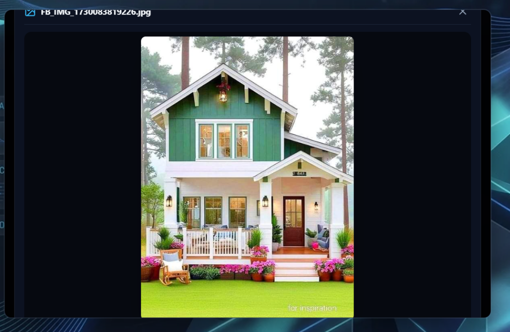
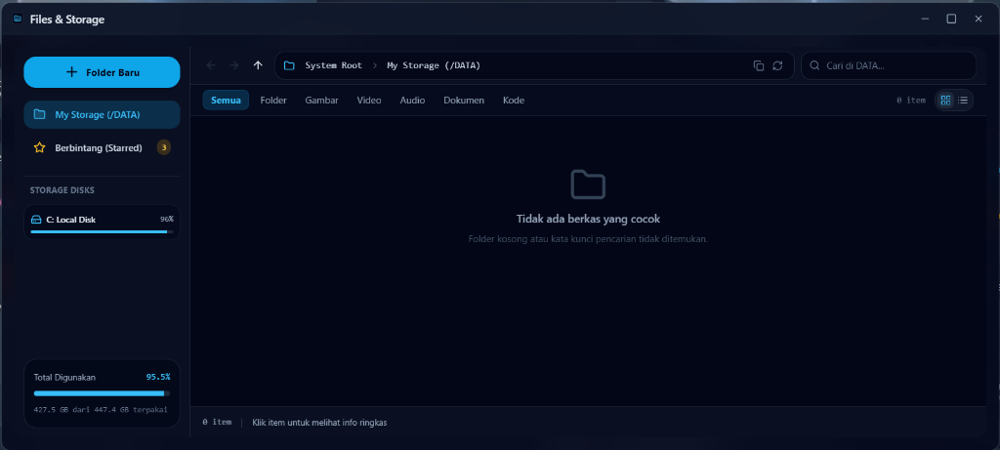
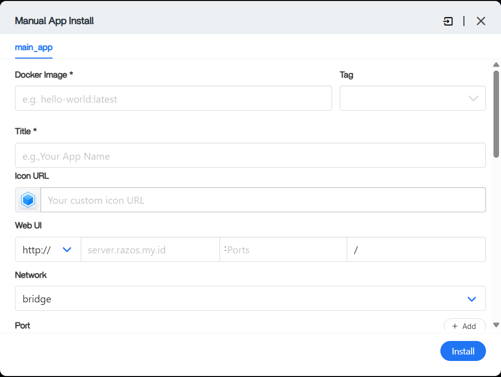
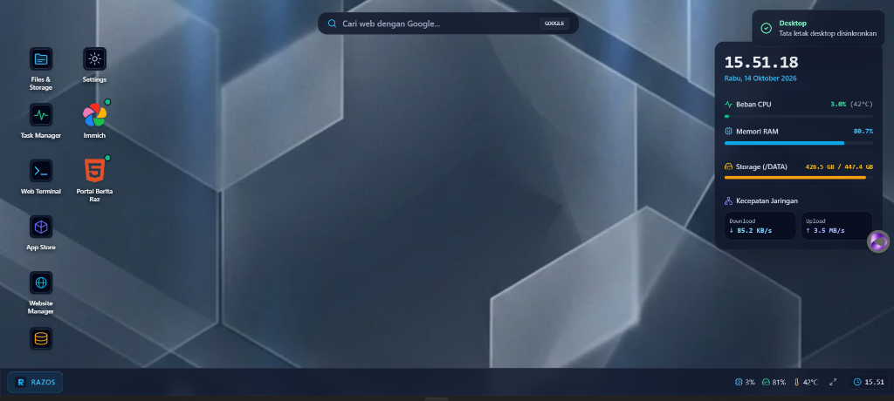
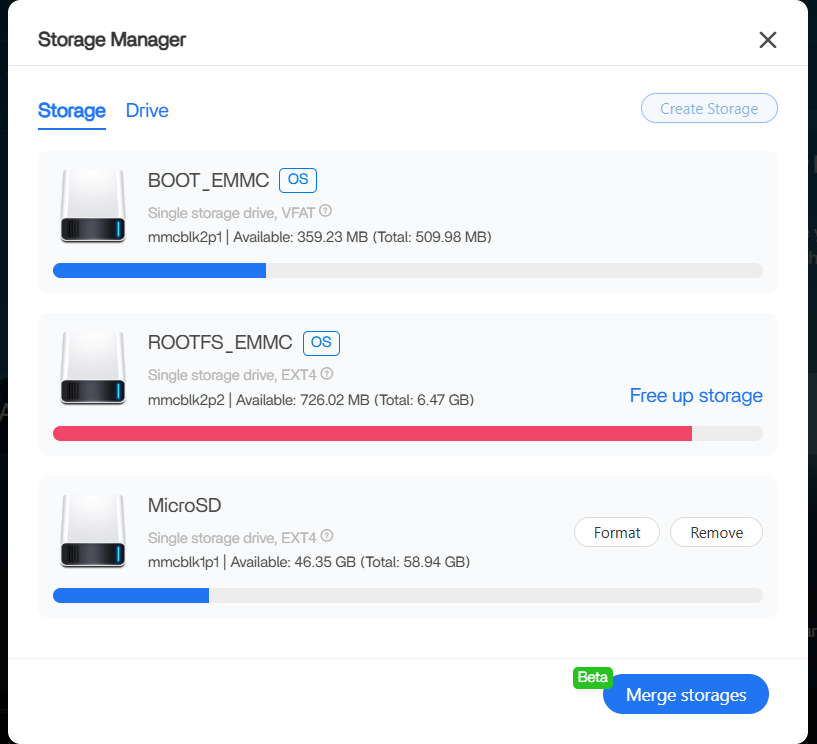
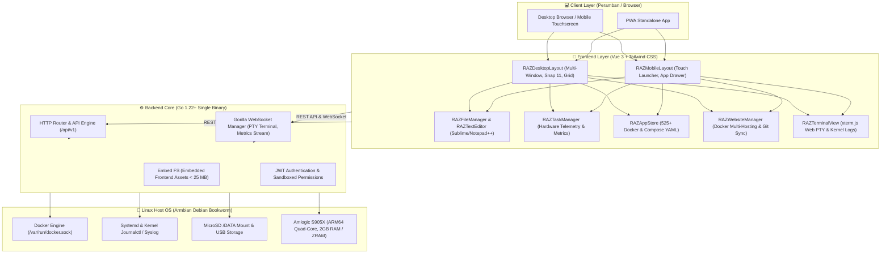

<p align="center">
  
</p>

<h1 align="center">RAZOS (RAZ Operating System)</h1>

<p align="center">
  <strong>High-Performance Web-Desktop OS & Cloud Server Platform for Low-Power SBC / STB Armbian.</strong>
</p>

<p align="center">
  Ubah STB TV Box murah dan Single Board Computer berbasis Armbian Linux menjadi server cloud pribadi yang andal, desktop multi-window modern, kluster kontainer Docker mandiri, dan hosting multi-website tanpa beban memori berlebih.
</p>

<p align="center">
  <a href="#see-it-work">Demo & Visual</a> ·
  <a href="#mengapa-razos">Mengapa RAZOS?</a> ·
  <a href="#arsitektur-sistem">Arsitektur</a> ·
  <a href="#fitur-utama">Fitur Unggulan</a> ·
  <a href="#spesifikasi-target-hardware">Spesifikasi Hardware</a> ·
  <a href="#instalasi--deployment">Instalasi</a> ·
  <a href="#struktur-proyek">Struktur Proyek</a>
</p>

<p align="center">
  
  
  
  
  
  
</p>

---

## See it work

Tampilan antarmuka nyata RAZOS yang berjalan langsung di peramban web — responsif, presisi tinggi, dan dirancang khusus untuk efisiensi perangkat keras berdaya rendah.

| Workspace Desktop Multi-Window | File Manager & Storage Explorer |
| :---: | :---: |
|  |  |
| *Desktop responsif dengan Windows 11 Snap Gesture, draggable & persistent icons.* | *File explorer hybrid, upload file/folder/ZIP auto-extract & text editor terintegrasi.* |

| Docker App Store & Compose Suite | Task Manager & Real Hardware Telemetry |
| :---: | :---: |
|  |  |
| *Katalog 525+ aplikasi Docker, CasaOS-style compose YAML & installer fleksibel.* | *Windows 11 style task manager, telemetry host riil, heatmap & streaming log.* |

| Storage Manager & Partisi Host |
| :---: |
|  |
| *Inspeksi kapasitas disk eMMC, partisi MicroSD `/DATA`, dan drive USB eksternal.* |

---

## Mengapa RAZOS?

Berbeda dengan dashboard web pada umumnya yang membebani memori dan mengorbankan performa, RAZOS direkayasa secara teliti untuk memaksimalkan setiap megabyte RAM pada perangkat keras berdaya hemat (*resource-constrained*).

| Kebutuhan Pengguna | Solusi yang Dihadirkan RAZOS |
| :--- | :--- |
| **Server Pribadi Hemat Daya** | Backend tunggal berbasis Golang murni dengan konsumsi RAM idle $\le 35\text{ MB}$, tanpa runtime berat seperti Python atau Node.js pada server inti. |
| **Pengalaman Desktop Sejati** | Multi-windowing lengkap, resize bebas lag, Windows 11 Snap-to-Top Maximize gesture, persistensi ukuran/posisi jendela per aplikasi, serta transisi animasi 60 FPS. |
| **Manajemen Berkas & Koding Lengkap** | Unggah file, folder bertingkat, dan arsip ZIP (auto-extract instan di server), serta Sublime Text / Notepad++ Style Code Editor multi-tab langsung di browser. |
| **Ekosistem Kontainer Mandiri** | Akses ke 525+ aplikasi Docker siap pakai, tab manajemen kontainer terpasang, editor Docker Compose YAML visual, dan integrasi context menu desktop. |
| **Hosting Multi-Website Ringan** | Dukungan website statis (HTML/Nginx Alpine 15 MB RAM), Micro-Framework API (Go, PHP Native, FastAPI), database SQLite tanpa memori layanan (0 MB RAM), dan auto-pull repositori GitHub via PAT. |
| **Akses Sistem & Log Kernel Riil** | Web Terminal SSH berbasis xterm.js dan PTY WebSocket, didukung penampil log Linux Armbian riil (`dmesg`, `journalctl`, `/var/log/syslog`). |

---

## Arsitektur Sistem

RAZOS memadukan arsitektur Single-Binary Backend berbasis Go dengan antarmuka Frontend Modern berbasis Vue 3 yang di-bundle secara efisien ke dalam satu executable mandiri melalui `embed.FS`.



---

## Fitur Utama

### 1. Antarmuka Desktop Multi-Window & Windows 11 Snap Gesture
- **Windowing Fleksibel:** Jendela dapat digeser, diubah ukuran (*resize*), di-*minimize* ke taskbar, dan di-*maximize*.
- **Windows 11 Snap-to-Top:** Menyeret jendela mentok ke atas memunculkan indikator halo preview dan auto-snap ke layar penuh; menyeretnya turun mengembalikannya ke ukuran semula.
- **Persistensi Jendela & Ikon Desktop:** Ukuran, posisi koordinat, dan letak ikon pada grid desktop tersimpan otomatis ke `RAZDesktopConfig.json` sehingga tetap konsisten saat berpindah perangkat.
- **Mobile Adaptive Launcher:** Secara otomatis beralih ke tata letak sentuh mobile (App Drawer & App Switcher) saat diakses melalui smartphone ($\le 768\text{px}$).

### 2. File Manager Canggih & Sublime-Style Code Editor
- **Navigasi Explorer Windows:** Breadcrumbs interaktif, editable path address input, history Back/Forward/Up, Copy Path, dan Refresh.
- **Suite Unggah Lengkap:** Mendukung unggah berkas tunggal/banyak, unggah direktori bertingkat (*folder upload*), dan unggah arsip ZIP dengan fitur auto-extract otomatis di server.
- **Sublime Text & Notepad++ Enterprise Editor:** Editor kode multi-tab dengan nomor baris (*line gutter*), pencarian & penggantian teks terapung (*floating Find & Replace* `Ctrl+F` / `Ctrl+H`), lompat ke baris (*Go to Line* `Ctrl+G`), serta status bar kursor, karakter, kata, encoding UTF-8, dan indentasi.
- **Media Viewers Terintegrasi:** Image Viewer (zoom/rotate), Video Player, Music Player dengan animated waveform visualizer, PDF Reader, dan Markdown Document Suite.

### 3. App Store 525+ Docker & CasaOS-Style Compose Suite
- **Katalog Lengkap:** Akses instan ke 525+ template kontainer Docker siap pasang.
- **Metode Instalasi Fleksibel:** Mendukung 1-klik template, upload file `docker-compose.yml`, instalasi via Docker CLI, dan custom wizard.
- **Manajemen Kontainer Terpasang:** Tab khusus untuk memantau status hidup kontainer, membuka Web UI, restart, dan clean uninstall tanpa meninggalkan data sampah.

### 4. Task Manager & Telemetry Hardware Riil (Zero Dummy Data)
- **Metrik Sistem Akurat:** Menampilkan nama host, spesifikasi CPU asli, jumlah core, utilisasi RAM fisik, temperatur prosesor, dan ruang penyimpanan riil host.
- **Visual Heatmap & Kontrol Proses:** Heatmap utilisasi sumber daya tinggi serta kill-switch instan (Akhiri Tugas).
- **Log Streaming Kontainer:** Pemantauan output log kontainer Docker secara langsung (*real-time streaming*).

### 5. Website Manager & Multi-Hosting Terisolasi
- **Optimasi Khusus STB ARM64:** Menyediakan 4 kategori hosting ramah memori (Website Statis Nginx Alpine 15 MB RAM, Micro-Framework Go/PHP/FastAPI, Flat-File CMS, dan Internal Portal).
- **SQLite Default (0 MB Service RAM):** Mencegah kelebihan beban memori MySQL dengan database berbasis berkas.
- **Integrasi GitHub Repository:** Menghubungkan repositori privat atau publik dengan Personal Access Token (PAT) untuk *auto-pull* kode produksi ke direktori website.

### 6. Web Terminal SSH & Log Sistem Armbian
- **Web PTY xterm.js:** Akses terminal host langsung dari peramban dengan proteksi sesi aman.
- **Armbian System Logs:** Filter dan pelacakan log kernel host secara langsung dari `dmesg`, `journalctl`, `/var/log/syslog`, dan log autentikasi.

---

## Spesifikasi Target Hardware

RAZOS dirancang dan diuji secara spesifik untuk perangkat keras berbiaya rendah:

| Komponen | Spesifikasi Rekomendasi |
| :--- | :--- |
| **SoC / Prosesor** | Amlogic S905X / S905W / S905X3 / Allwinner H616 (Quad-Core ARM Cortex-A53 @ 1.5–2.0 GHz) |
| **Arsitektur** | ARM64 (`aarch64`) |
| **Sistem Operasi** | Armbian Linux (Debian 12 Bookworm / Ubuntu Jammy) |
| **Memori RAM** | 1.8 GiB DDR3 / DDR4 (Minimum 1 GiB) |
| **Swap Memori** | ZRAM Swap ~900 MiB terkonfigurasi aktif |
| **Penyimpanan Internal** | eMMC 8 GB (dikhususkan untuk OS kernel & system boot) |
| **Penyimpanan Utama** | MicroSD / USB External SSD berkapasitas $\ge 32\text{ GB}$ dimount di `/DATA` |

### Jejak Sumber Daya (Resource Footprint)

| Komponen | Konsumsi RAZOS |
| :--- | :--- |
| **Memori Idle (Backend)** | $\le 35\text{ MB}$ RAM |
| **Ukuran Binary Executable** | $\approx 18 - 25\text{ MB}$ (termasuk static assets terkompresi) |
| **Beban CPU saat Idle** | $< 1.5\%$ pada quad-core ARM64 |
| **Direktori Data Aplikasi** | Terisolasi di `/DATA/razos/` dan `/DATA/apps/` |

---

## Instalasi & Deployment

### 1. Pemasangan Otomatis (STB Armbian)

Jalankan perintah instalasi satu baris berikut di terminal SSH STB Anda:

```bash
curl -fsSL https://raw.githubusercontent.com/razcreativestudio/razos/main/scripts/install.sh | bash
```

Setelah instalasi selesai, buka peramban web Anda di komputer atau ponsel:
```text
http://<IP-STB-ANDA>:8080
```

---

### 2. Pengembangan Lokal (Development Setup)

#### Prasyarat
- Go 1.22 atau lebih baru
- Node.js 18+ & npm
- Docker Engine aktif

#### Menjalankan Frontend
```bash
# Masuk ke direktori frontend
cd frontend

# Pasang dependensi
npm install

# Jalankan server pengembangan Vite
npm run dev
```

#### Menjalankan Backend (Go)
```bash
# Dari root proyek
go run main.go
```

Buka `http://localhost:3000` di peramban Anda.

---

### 3. Kompilasi Produksi (Production Build)

Kompilasi frontend menjadi aset statis dan rangkai ke dalam binary Go tunggal:

```bash
# 1. Build frontend Vite
cd frontend
npm run build
cd ..

# 2. Build Go binary untuk STB ARM64
env GOOS=linux GOARCH=arm64 go build -ldflags="-s -w" -o razos-arm64 main.go
```

Binary `razos-arm64` siap dijalankan langsung di STB tanpa dependensi tambahan.

---

## Struktur Proyek

```text
razos/
├── backend/                  # Modul dan controller backend Go
│   ├── api/                  # Handler REST API (Files, Apps, Websites, Telemetry)
│   ├── auth/                 # Autentikasi JWT dan manajemen sesi pengguna
│   ├── docker/               # Docker Engine SDK client & compose orchestrator
│   ├── pty/                  # Terminal PTY WebSocket handler
│   └── system/               # Telemetry hardware host, storage devices & logs
├── frontend/                 # Aplikasi Frontend Vue 3 + Tailwind CSS
│   ├── public/               # Aset statis & logo resmi (assets/brand/)
│   ├── src/
│   │   ├── components/       # Komponen UI modular (Custom Modals, Window Frame)
│   │   ├── layouts/          # RAZDesktopLayout & RAZMobileLayout
│   │   ├── stores/           # Pinia Stores (Window, System, ContextMenu)
│   │   └── views/            # RAZFileManagerView, RAZTextEditorView, dll
│   └── package.json
├── docs/                     # Dokumentasi arsitektur, panduan, dan media
│   └── media/                # Tangkapan layar resmi & aset grafis dokumentasi
├── backup/                   # Direktori arsip backup otomatis sebelum update kode
├── update-history/           # Catatan riwayat pembaruan harian
├── main.go                   # Titik masuk utama aplikasi Go
├── GEMINI.md                 # Standar kualitas sistem & protokol pengembangan
└── Readme.md                 # Single source of truth dokumentasi proyek
```

---

## Roadmap & Pembaruan

Pembaruan dicatat secara berkala pada berkas riwayat harian di folder [`update-history/`](./update-history/).

- [x] Multi-Window Desktop & Windows 11 Snap Gesture
- [x] Grid & Drag-and-Drop Ikon Desktop dengan Sinkronisasi Server
- [x] File Manager Hybrid (Breadcrumbs, Virtual Scrolling, Thumbnail Caching)
- [x] Unggah File, Folder, dan ZIP Auto-Extract
- [x] Sublime Text & Notepad++ Enterprise Code Editor Multi-Tab
- [x] App Store 525+ Docker dengan Dukungan Compose YAML
- [x] Task Manager Hardware Host Riil (Zero Dummy Data)
- [x] Website Manager & Multi-Hosting Ringan (Nginx Alpine + SQLite)
- [x] Web SSH Terminal & Linux Armbian Kernel Logs Streamer
- [ ] Dukungan Multi-User & Manajemen Izin Akses Peran (RBAC)
- [ ] Sinkronisasi Cloud Eksternal (rclone WebDAV / Nextcloud integration)

---

## Kontribusi & Lisensi

Kontribusi dan saran perbaikan sangat kami nantikan! Silakan buat *Issue* atau ajukan *Pull Request* di repositori resmi:
👉 [https://github.com/razcreativestudio/razos](https://github.com/razcreativestudio/razos)

Proyek ini dilisensikan di bawah lisensi **MIT**. Silakan gunakan, pelajari, dan kembangkan secara bebas untuk kebutuhan personal maupun komunitas.
